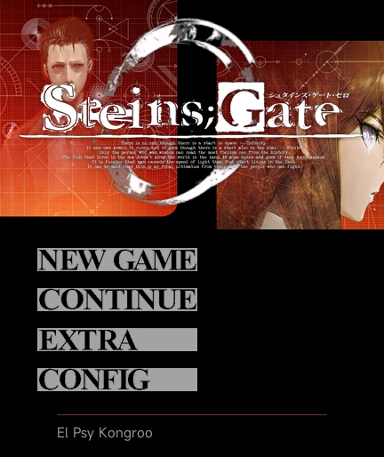

# 《命运石之门0》REDMI Watch 5

Windows 原作资源转换的非官方图文移植，使用轻量场景阅读器运行于 Xiaomi Vela。作者／维护：**xuanyide**。资源解析、转换工具、移植代码、界面与自动化检查由 **Codex** 完成，实机测试与反馈由维护者提供。

**当前版本：0.2.1。2026-10-25 维护者反馈实机测试通过。** 安装包24,796,849字节，约24.80 MB，小于25,000,000字节。目标设备REDMI Watch 5，包名`com.codex.steins0.rw5`，与《命运石之门》独立。

[下载与发布说明](https://github.com/xuanyide01/steins0-rw5/releases/tag/v0.2.1) · [安装说明](INSTALL.md) · [实机反馈](HARDWARE_TEST.json) · [检查说明](VALIDATION.md)

## 标题预览

静态PNG与动态GIF均来自本版官方Vela模拟器的实际屏幕，分辨率432×514。GIF约4秒循环、目标采集15fps；这是录屏采样率，游戏标题仍保留60个原作姿态、约30fps的调度，不是实机帧率测量。




## 功能

- 简体中文剧情、角色立绘、背景与CG。画面保持原比例置于上方，下方为可点击推进、可滑动的正文。
- 六条结局路径，保留关键电话与手机电源操作，以及《盟誓的文艺复兴》通关记录对真结局的影响。
- 30个存档栏位，自选读取；保存后直接返回原剧情或电话选择界面。兼容0.1.0以来的原存档键与格式。
- 原作路线／章节选择，章节开头显示标题CG。“下一章”跳到下一原作章节或关键手机操作，普通RINE与非关键电话可略过；序章跳章会停在OP。
- CG鉴赏每页四组缩略图，同组差分点击切换；OP在序章后播放，也可从EXTRA独立观看，点击画面跳过。
- 小／中／大三档字号；逐字／逐句／即时显示；三档自动播放，遇关键选项暂停，打开菜单、存读档、拖动正文或转入后台时暂停。
- 手机提供收信箱、已发送和联系人；同一会话合并多条信息，详情在同一页上下滚动，可回复并查看后续信息。列表用“动画表情”作摘要，详情显示原作表情图。
- 联系人与信息可见性跟随剧情状态；显式世界线重置清理对应收发历史，普通显示重置保留历史。可回复时机由原作窗口控制。
- 立绘造型、表情与站位遵循原作脚本，包括原作沿用的前作造型；Amadeus发言在缺少数字立绘图层时补充手机屏幕式红莉栖立绘。
- 原作完整动态标题、NEW GAME／CONTINUE／EXTRA／CONFIG按键、原作标题曲和圆形应用图标。标题空白区域不作按键，文字与装饰预留圆角边距。
- CONFIG统一开关标题曲与OP声音；可关闭标题动画。标题不显示世界线变动率。

## 0.2.1修复

完成《交差坐标的星尘》后，原作会同时登记它和《无限远点的牵牛星》的通关记录。旧版只保存最后一个结局，正常阅读与跳章均可能漏记。新版依据原作CLRFLG结算脚本补齐F806与F804的对应关系。

旧版已通关真结局却缺少前章记录的数据，在启动时自动补正并写回，无需重打；加载旧存档时也应用同一规则。其他记录和存档保留。仅进入章节不提前结算，单独完成《无限远点的牵牛星》不反向解锁真结局。

0.2.1只改通关记录和版本信息；全部853个正文分块、剧情图、RINE数据、CG、立绘、字体、标题曲与8fps OP均与0.2.0逐字节相同。源码与安装包SHA-256见Release。

## 实现与性能

原SC3控制流在电脑转换阶段执行，手表读取预生成场景图，不运行原引擎与演出线程。正文按最多40句分块，最大分块7,938字节，仅缓存当前块；历史回看限制8句。原作面部图层预先合成，920个立绘复用基底与表情差分；不透明CG由剧情和鉴赏共用，PNG做无损重编码以减少重复占用。

背景／CG按手表显示尺寸缩放，立绘使用调色板压缩。完整语音、音效、剧情背景音乐及全部转场演出未包含。标题曲为单声道PCM，主动停止并延迟重播，后台与销毁释放媒体、取消定时器。

OP约110.48秒，保留884个画面、目标8fps；每帧256×144，四帧组成1024×144横向小图集，显示384×216居中视口。单图片、单时钟按时间选帧，晚到不集中补绘。进入OP隐藏阅读UI，结束或跳过后接第一章标题CG。

沿用0.2.0低解压封装：图片、音频、字体及大部分小文本直接STORE，仅45个文本文件保留DEFLATE，减少安装时的重复解压工作。它不等同于测得所有固件的安装峰值内存。0.2.1已有维护者实机通过反馈；具体固件和耐久时长未记录，检查范围见[实机反馈](HARDWARE_TEST.json)。

## 安装

从Release下载`.bin`，用[表盘自定义工具](https://www.bandbbs.cn/)等兼容工具安装。**手机显示蓝牙传输完成后，还需等待手表解包与应用图标登记。** 已装旧版时优先正常覆盖更新，更新前保留重要进度；卸载或恢复出厂设置可能清除存档。

如未出现图标或发生崩溃，先停止重复传输，记录版本、工具提示和操作位置，尝试正常重启。进入应用后可先在CONFIG关闭声音和标题动画再定位问题。详细处理见[INSTALL.md](INSTALL.md)。

## 构建与检查

仓库包含转换后的`src/`，正常构建无需读取或修改Steam原游戏。需Node.js与npm：

```powershell
npm install --prefix tools/compat-toolkit --ignore-scripts
npm run build -- --development
npm test
```

编译器固定为`aiot-toolkit@1.1.0`；已有安装可设置`WATCH_COMPAT_TOOLKIT`。构建会暂时排除不被运行器读取的`assets.txt`离线清单，并在结束后恢复；使用原签名／R1包装和25MB上限。

`npm test`可使用仓库转换后资源运行六路线、关键电话、RINE回复、跳章、存档、UI与媒体检查。重做资源转换或执行原SC3审计，需另行提供合法原版资源与脚本反编译中间文件；原始Windows可执行文件、完整解包档案及分析环境不随仓库发布。历史转换脚本中的本机路径需要自行配置。

官方Vela模拟器工具需另装SDK、`@aiot-toolkit/emulator`与ADB，设置`WATCH_SDK_HOME`、`STARRY_EMULATOR_HOME`及依赖路径，再运行`tools/setup-emulator.cjs`和`npm run preview`。控制服务仅监听本机`http://127.0.0.1:43141/`。

## 验证证据

- `reports/clear-awards-v021-source.json`：原作六种结算奖励，真结局同时写入[3,5]。
- `reports/clear-awards-v021-tests.json`：六路线跳章／恢复、旧存档补正与不反向解锁。
- `reports/ui-v021-tests.json`：旧全局记录自动补正、持久化／幂等、两页通关列表及既有UI检查。
- `reports/compatibility-v021.json`与`package-audit-v021.json`：资源一致性、ZIP CRC、内外签名及全部文件摘要。
- `native-test-results-v021/`：准确SHA包安装、系统冷启、跳章结算、两页已完成记录及原0.1.0存档恢复的模拟器证据。
- [HARDWARE_TEST.json](HARDWARE_TEST.json)：维护者0.2.1实机反馈，独立于模拟器报告记录。

## 致谢与授权

感谢 @liuyuze61 的两部社区移植作品为最初研究提供参考：

- [《ATRI》1.5.1](https://api.bandbbs.cn/wftools/bandbbs.html?code=A&state=1820673)
- [《星空列车与白的旅行》v1.0.0](https://api.bandbbs.cn/wftools/bandbbs.html?code=A&state=1841662)
- 感谢[“表盘自定义工具”及相关团队](https://www.bandbbs.cn/)提供安装工具。

脚本与资源格式研究参考Committee of Zero的[MgsScriptTools](https://github.com/CommitteeOfZero/MgsScriptTools)、[sc3tools](https://github.com/CommitteeOfZero/sc3tools)、[impacto](https://github.com/CommitteeOfZero/impacto)，路线核对参考其[《命运石之门0》攻略](https://sonome.dareno.me/projects/sg0-walkthrough.html)。安装封装参考open-vela的公开实现。工具与参考内容的许可见[THIRD_PARTY_NOTICES.md](THIRD_PARTY_NOTICES.md)。

自编代码采用[MIT](LICENSE)。原作《命运石之门0》的剧情、人物、图像、标题、音乐、字体及转换后的素材归各权利人所有，不适用自编代码的MIT许可；本项目不据此授予原作素材权利。请支持并合法持有原作。
